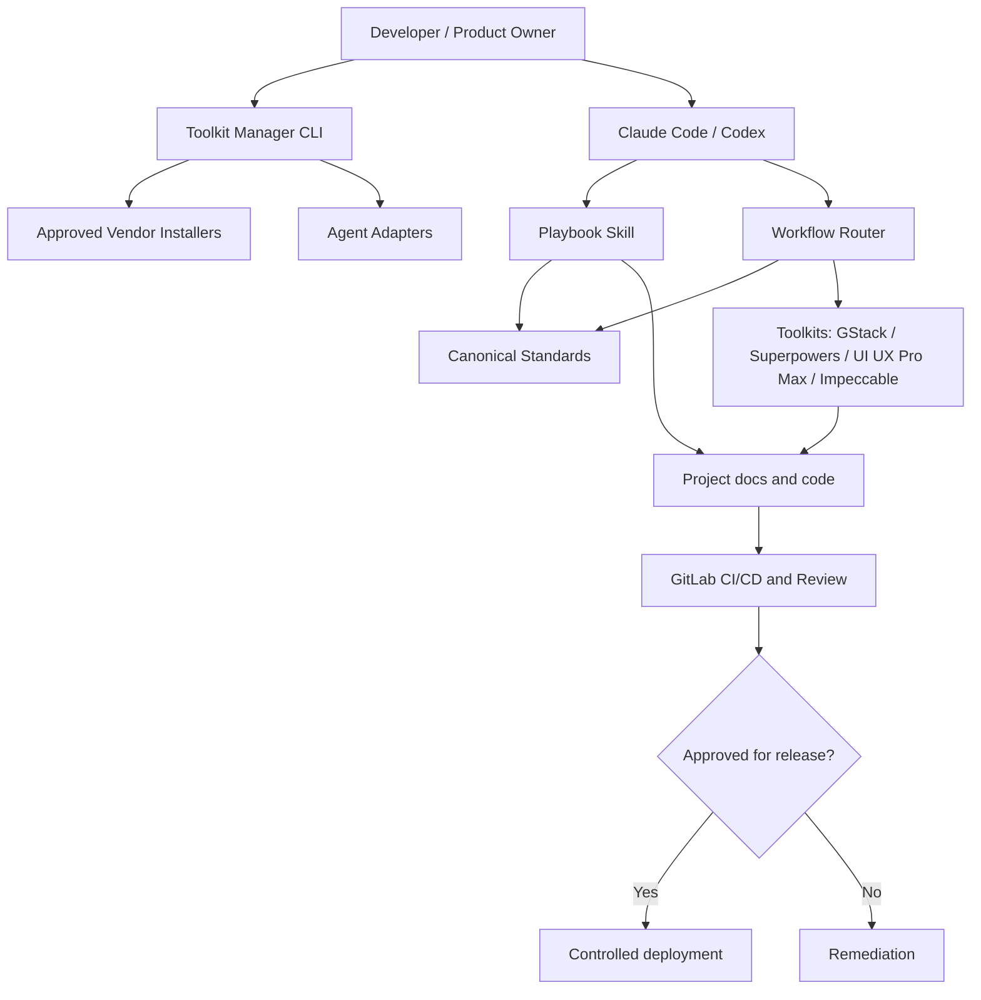

# AI Engineering Toolkit — Architecture & Integration Specification

## 1. Executive Decision

**Decision:** Build one internal, agent-agnostic engineering standard with two lightweight internal skills (**software-engineering-playbook** and **engineering-workflow-router**) plus an explicit **toolkit manager** that installs and verifies independent third-party toolkits. Do **not** fork or merge third-party skill sources into one giant skill. **GitLab CI/CD, not agent prose, is the final technical enforcement layer.**

Product boundaries:
- **Standards** define required artifacts, risk profile, quality gates, and ownership.
- **Playbook skill** audits/scaffolds/updates project documentation based on standards.
- **Workflow router** selects a preferred workflow and identifies required evidence; it does not install tools or bypass approvals.
- **Toolkit manager (CLI)** installs, diagnoses, locks, updates, and optionally removes integrations.
- **Adapters** translate canonical conventions to Claude Code and Codex. Their installed features are not assumed equivalent.
- **Third-party toolkits** execute their own native capabilities; their source remains separately versioned.

## 2. Goals, Non-Goals and Constraints

### Goals
1. A single documentation and engineering source of truth across Claude Code and Codex.
2. Three risk-based profiles: `lean`, `standard`, `business-critical`.
3. Two skill modes: `initialize` and `audit-upgrade`, plus `refresh` for approved documentation changes.
4. Predictable routing with clear primary/secondary responsibilities and fallback.
5. Repeatable installs with dry-run, backup, state manifest, pinned sources, and diagnostics.
6. Existing documentation, settings, secrets and hooks remain intact unless changes are explicitly approved.
7. Human-controlled release to production; objective evidence from CI/tests.

### Non-goals (v1)
- Building a new coding methodology, design engine, testing framework, or deployment platform.
- Automatically downloading and running arbitrary scripts from changing branches.
- Replacing GitLab issues, merge requests, or release approvals.
- Promising tool support merely because an install folder exists.
- Building an agent that autonomously changes production infrastructure.

### Constraints
- Support Linux/macOS first; Windows and WSL support must be explicitly tested before declared supported.
- Use Python 3.11+ standard library for the manager prototype; call vendor CLIs only via explicitly approved adapters.
- Support both user (`global`) and project (`project`) scope where the vendor supports them.
- All policy schemas are versioned; no silent incompatible migration.

## 3. Architecture



**Policy precedence:** (1) repository safety and explicit human approvals; (2) approved project requirement/architecture and `standards/`; (3) project-scoped adapter instruction; (4) upstream toolkit workflow. A higher-level rule does not automatically make external vendor hooks enforceable; CI and approvals enforce critical gates.

**Single source of truth:** `docs/` contains the project knowledge; `.engineering/project.yaml` records project policy; vendor-specific generated artifacts may live in native folders but should be linked or reconciled, not copied and diverged.

## 4. Repository Blueprint

```text
ai-engineering-toolkit/
├── README.md
├── standards/
│   ├── profiles.yaml
│   ├── documentation-standard.md
│   ├── quality-gates.yaml
│   └── workflow-routing.yaml
├── skills/
│   ├── software-engineering-playbook/
│   │   ├── SKILL.md
│   │   ├── references/
│   │   └── templates/
│   └── engineering-workflow-router/
│       ├── SKILL.md
│       └── references/
├── integrations/
│   ├── gstack.yaml
│   ├── superpowers.yaml
│   ├── ui-ux-pro-max.yaml
│   └── impeccable.yaml
├── adapters/
│   ├── claude/
│   └── codex/
├── manager/
│   ├── cli.py
│   ├── install.py
│   ├── doctor.py
│   ├── lock.py
│   ├── update.py
│   ├── uninstall.py
│   └── providers/
├── templates/project/
│   ├── README.md
│   ├── AGENTS.md
│   ├── CLAUDE.md
│   ├── .engineering/project.yaml
│   └── docs/
├── tests/
│   ├── fixtures/
│   ├── unit/
│   └── integration/
└── docs/
    ├── architecture.md
    ├── security-model.md
    ├── contribution.md
    └── operational-runbook.md
```

Target project layout:
```text
my-application/
├── README.md
├── AGENTS.md
├── CLAUDE.md
├── .engineering/
│   ├── project.yaml
│   └── toolchain.lock.yaml
├── docs/00-governance/ ... docs/08-reference/
├── src/
├── tests/
└── .gitlab-ci.yml
```
Only create folders that are justified by the chosen profile; do not generate empty bureaucratic documents by default.

## 5. Profiles and Minimum Artifacts

| Requirement | Lean | Standard | Business Critical |
|---|---|---|---|
| Project charter/scope | concise | required | required + accountable signoff |
| BRD, PRD, SRD | combined allowed | distinct or linked non-duplicative docs | distinct + approved + traceable |
| SAD and significant ADRs | architecture overview | required | required + independent architecture review |
| UI/UX specs | where UI exists | where UI exists | UI, accessibility, approval where material |
| Roadmap/backlog/plan | lightweight plan | tracked issues + current plan | tracked dependencies and risk |
| Automated verification | relevant tests | tests + CI checks | risk-based suites + evidence |
| Auth/security | baseline | review + automated scans | threat model, access matrix, abuse cases |
| Operations | local run instructions | deployment, rollback, runbook | RPO/RTO, restore tests, observability, DR |
| Release | manual checklist | CI gate + owner approval | separated business/technical approval |
| Traceability | optional | requirement IDs and critical-test links | end-to-end traceability evidence |

**Escalation rule:** Data sensitivity, financial integrity, operational safety, legal obligations, and high outage impact can elevate a project or feature above its default profile. **Business Critical is not equivalent to complex UI.** No profile relaxes prohibitions on secret exposure, unauthorized production deployment, or unverified test claims.

## 6. Integration Contracts

Each `integrations/*.yaml` must define:

```yaml
schema_version: 1
id: superpowers
upstream:
  repository: https://github.com/obra/superpowers
  verified_ref: REPLACE_WITH_APPROVED_TAG_OR_COMMIT
license_review: pending
hosts:
  claude:
    support: supported-or-pending-verification
    installation: vendor-plugin-or-approved-adapter
  codex:
    support: supported-or-pending-verification
    installation: vendor-plugin-or-approved-adapter
capabilities:
  primary: [implementation-planning, tdd, debugging, code-review]
  secondary: [brainstorming]
required_runtime: []
possible_hooks: true
allowed_paths: []
verification:
  install_check: REQUIRED
  invocation_smoke_test: REQUIRED
security:
  network_behavior_reviewed: false
  executable_hook_reviewed: false
  secrets_access_reviewed: false
```

Vendor integration responsibilities (verified from upstream documentation on 2026-10-31, re-check before installation):

| Toolkit | Primary role | Routing limitations |
|---|---|---|
| GStack | product discovery, stakeholder review, functional QA | overlapping engineering/release skills are secondary; Codex integration currently marked experimental by upstream |
| Superpowers | engineering planning, implementation, TDD, debugging, code review | do not run a second mandatory planning loop after approved plans; installation differs per host |
| UI UX Pro Max | design exploration, style system, UI construction guidance | may activate automatically; design standards still come from approved project requirements |
| Impeccable | design critique, refinement, anti-pattern checks | hook installation is explicit and needs review/trust; `PRODUCT.md` must not become a divergent business source |

Upstream sources:
- GStack: https://github.com/garrytan/gstack (includes `./setup --host claude|codex`; Codex tier experimental)
- Superpowers: https://github.com/obra/superpowers (Claude plugin marketplace; Codex support documented)
- UI UX Pro Max: https://github.com/nextlevelbuilder/ui-ux-pro-max-skill (`uipro init --ai claude|codex`)
- Impeccable: https://github.com/pbakaus/impeccable (`npx impeccable install --providers=claude,codex --scope=...`)

Upstream capability lists and commands may change. Install adapters must version-test these interfaces; no unpinned `latest` in unattended setup.

## 7. Workflow Routing Rules

Deterministic routing, not broad automatic chaining:

| Intent | Primary | Optional secondary | Required handoff |
|---|---|---|---|
| Business discovery and opportunity | GStack | Playbook | problem statement, assumptions, owner decisions → BRD |
| Requirements writing / reconciliation | Playbook | GStack for challenge | approved BRD/PRD/SRD references |
| UI/UX proposal | UI UX Pro Max | Impeccable critique | design spec, interaction states |
| UI/UX audit | Impeccable | GStack design review if valuable | prioritized findings, acceptance criteria |
| Technical design | Superpowers planning + project architecture rules | GStack engineering review | SAD/ADR change proposal, approved plan |
| Coding / refactor | Superpowers | Playbook doc sync | implemented requirement IDs, tests, change summary |
| Incident / bug | Superpowers debugging | security or QA as needed | reproduction, root cause, regression test |
| Functional QA | GStack QA where supported | Superpowers tests | defect evidence and severity |
| Documentation audit | Playbook | — | gap matrix and safe change plan |
| Release | GitLab CI/CD + human owner | GStack ship support optionally | green gates, approval, rollback, release notes |

Rules:
1. Resolve project profile and task intent first. Prefer **one primary owner per phase**.
2. Use cross-tool review only for risk/uncertainty or explicit request; avoid duplicate brainstorming/planning loops.
3. Skill router suggests native invocations, but does not pretend remote tool invocation works if absent.
4. If a required toolkit is unavailable, report the gap; for noncritical jobs use safe manual workflow, for critical jobs block the affected gate.
5. Persist only durable decisions in canonical docs; store task execution evidence in issue/MR/CI artifacts.
6. No autonomous `ship` step to production. Every deploy requires explicitly authorized release mechanism.

## 8. Tooling Installation and Lifecycle

Commands below specify the **future internal CLI contract**, NOT implemented commands:

```bash
python3 -m manager.cli plan --agent claude,codex --profile standard --scope global
python3 -m manager.cli install --agent claude,codex --profile standard --scope global
python3 -m manager.cli doctor --agent claude,codex
python3 -m manager.cli init-project --path ./my-application --profile standard
python3 -m manager.cli update --check
python3 -m manager.cli update --apply --approved-lock ./toolchain.lock.yaml
python3 -m manager.cli uninstall --component impeccable --dry-run
```

### Install transaction
1. **Discover** host OS, runtime, agent installation, workspace, current skill paths, native plugin state, settings and hooks; no mutations.
2. **Resolve** compatibility matrix, approved pinned versions, actual vendor installation path and required dependencies.
3. **Plan** list of intended file changes, commands, network destinations, capabilities, hook effects, and conflicts.
4. **Approval** human explicitly approves running vendor installers, modifying hooks, and updating agent settings.
5. **Backup** only touched files with hashes and metadata; never silently overwrite user-managed content.
6. **Install** own skills/adapters first and vendor components via their reviewed supported routes. Record each action.
7. **Verify** file presence, native discoverability, simple invocation, hook trust/consent and optionally behavior tests.
8. **Lock** manifest with resolved ref/commit, version, content hash where available, install scope, paths and verification status.
9. **Report** installed / partially installed / missing / unsupported / unverified clearly. Failure triggers safe rollback where possible.

### Safety and conflict policy
- Dry-run is default in unattended automation.
- Treat vendor installers and git hooks as executable third-party code.
- No `curl | sh`, no anonymous unreviewed scripts, no auto-sudo, no forced clean/reset, no automatic credential prompts.
- No automatic change to GitLab/production, auth tokens, secrets, telemetry settings or MCP privileges.
- Conflicting `CLAUDE.md`, `AGENTS.md`, hook and plugin settings: propose a patch, do not blind-append or replace.
- Check licensing and redistribution before packaging vendor artifacts; do not vendor them by default.
- Disabling/overriding vendor auto-update needs explicit check of support; favor pinned project-local versions for repeatability.
- Uninstall removes only files recorded as managed with matching hashes; modifications by user require review.

### State machine
`not-installed → planned → approved → installing → verified` or `partial / failed / blocked`. A file existing on disk means **installed**, not necessarily **verified**. `doctor` reports separate `installed`, `loadable`, `invocable`, `hook-trusted`, `workflow-tested` dimensions.

## 9. Documentation Governance

`software-engineering-playbook` behaviors:
- Initialize: detect repo, read existing docs, select profile, propose manifest, create only missing artifacts with `TBD` where unknown.
- Audit-Upgrade: report compliance by category; identify conflicts and missing approvals; no mass rewrite of approved files.
- Refresh: after a change, identify impacted BRD/PRD/SRD/SAD/ADR/test/ops docs and create a reviewed patch.
- Mark file status as `draft`, `in-review`, `approved`, `deprecated`.
- Stable IDs: `BR-`, `FR-`, `NFR-`, `ADR-`, `TC-`, `RSK-`; GitLab issue/MR is execution tracking, not duplicated backlog.
- Docs live in Git with MR review. Approved documents require authorized reviewers for substantive changes.
- Preserve requirement traceability through change request, code, test evidence and release record.

## 10. Engineering Gates (by profile)

| Gate | Lean | Standard | Business Critical |
|---|---|---|---|
| Requirement clarity | acceptance criteria | linked requirement IDs | approval + traceability |
| Code hygiene | relevant lint/test | automated lint/type/test/build | plus coverage of critical paths and independent review |
| Security | baseline secrets/input/auth | scanning + access review | threat-model controls and separate review |
| QA | smoke test | acceptance + regression | scenario matrix and signed UAT where material |
| Operations | run instructions | rollback and runbook | tested restore and RTO/RPO evidence |
| Deployment | owner decision | approved GitLab release gate | separated tech and business approval |

Quality gate claims must be backed by machine results or signed human records. Do not use a self-declared “all tests pass” as evidence.

## 11. GitLab Integration

- Protected `main`/release branches; merge request approvals per profile; no AI auto-merge to protected branch.
- Stage model: `validate` → `unit` → `integration` → `security` → `build` → `staging` → `acceptance` → `deploy`.
- Use SAST, dependency/secret/SBOM scanning where available; verify available capabilities on the actual **self-hosted GitLab Free** installation, using compatible external tools if necessary.
- Upload test, coverage, SAST, dependency and SBOM artifacts as files; do not store generated CI reports in docs unnecessarily.
- Deploy production uses protected environment/manual authorized job; rollback runbook linked in release record.
- CI template should be language-specific; do not assume Python/Node/etc without project evidence.

## 12. Security and Data Protection

Threats: malicious third-party installer, dependency compromise, prompt injection in external skills, untrusted generated commands, unintended secrets exposure, excessive shell/network permission, hook collisions, release override, data leaking to AI providers.

Minimum controls:
- Source review and pin all installed vendor components; preapprove their hashes/commits where practical.
- Require human review of executable hooks, install scripts, network access and privacy/telemetry behavior.
- Least privilege, separate development/staging/production credentials, no raw production data in AI context without authorized handling.
- Sanitized fixtures, dedicated sandbox directories, path validation to avoid traversal and symlink attacks.
- Log tool version, installation outcomes and policy decisions but never record secrets.
- Cross-platform hooks may differ; a warning surfaced in Claude is not evidence that Codex blocks the action.

## 13. Acceptance Criteria and Test Scenarios

### Functional acceptance
- AC-01: Initialize empty Lean project generates required lean docs, root agent instructions, and project manifest without inventing business requirements.
- AC-02: Initialize Standard project creates docs and architecture/quality/ops placeholders suitable for structured follow-up.
- AC-03: Business Critical profile introduces traceability, threat model, independent reviews and recovery controls.
- AC-04: Existing nonempty repository is audited without overwriting approved artifacts.
- AC-05: Router selects Superpowers for implementation and Impeccable for design critique; no duplicate default owner for each phase.
- AC-06: Missing vendor skill produces accurate missing-dependency diagnostics and safe fallback/block behavior.
- AC-07: Claude and Codex adapters refer to identical canonical docs; skill detection/invocation is verified separately per host.
- AC-08: Installer dry-run reports diff, commands, external calls, and hooks before changes.
- AC-09: Install is idempotent; second install with matching lockfile makes no destructive changes.
- AC-10: Partial failure reports exact component status and restores managed files wherever feasible.
- AC-11: Uninstall does not remove user-modified files or unmanaged skills.
- AC-12: Release cannot pass Business Critical gates without independent approval/evidence.

### Testing matrix
| Test | Lean | Standard | Critical |
|---|---:|---:|---:|
| Empty repo scaffold | yes | yes | yes |
| Existing approved docs conflict | yes | yes | yes |
| Missing agent/toolkit | yes | yes | yes |
| Existing hooks and settings | yes | yes | yes |
| Offline / network failure | yes | yes | yes |
| Reinstall idempotency | yes | yes | yes |
| Upgrade and rollback | optional | yes | yes |
| CI gate enforcement | smoke | full | full + approval |

## 14. Phased Delivery Plan

### Phase 0 — Standards & Specification
Deliver: this spec, schema examples, approved routing matrix, review of licensing and vendor install mechanisms. Exit when an engineering owner approves scope and security decisions.

### Phase 1 — Playbook v2
Deliver: canonical `standards/`, validated schemas, updated skill for Claude and Codex, project scaffolder (no external install). Exit when AC-01 through AC-04 and AC-07 pass.

### Phase 2 — Router v1
Deliver: deterministic task-to-tool mapping, capability detection, cross-agent paths and fallback. Exit when AC-05 and AC-06 pass in both hosts.

### Phase 3 — Manager v1
Deliver: `plan`, `install`, `doctor`, `lock`, `uninstall` with two reviewed integrations first, then four; version pinning and rollback. Exit when AC-08 through AC-11 pass.

### Phase 4 — GitLab & Pilot
Deliver: CI templates, release controls, pilot evidence on one new app, one existing app, one Business Critical domain. Exit when AC-12 and team usability checklist pass.

### Phase 5 — Update & Support
Deliver: tested update workflow, security review cadence, tool compatibility matrix, SOP, change log, ownership of each component.

## 15. Ownership and Decisions Requiring Confirmation

| Decision | Proposed default | Responsible approval |
|---|---|---|
| Hosting | private GitLab repository | Head of IT |
| OS support v1 | Linux and macOS | Technical Lead |
| Runtime | Python 3.11+ manager | Technical Lead |
| Default project profile | Standard | Project Owner |
| Global toolkit install | optional; explicit consent | Developer |
| Vendor updates | pinned/manual approval | Technical Lead/Security |
| Production deploy | controlled GitLab pipeline | Authorized release owner |
| Versioned data ownership | project docs as SoT | Product Owner |
| Third-party licensing | review before redistribution | Legal / responsible owner |

## 16. Definition of Done for Toolkit v1

1. Clean install of internal skills on both agents and verified discovery/invocation.
2. Four integrations have reviewed version lock, source, installer, diagnostics, and threat/telemetry assessment.
3. Lean/Standard/Business Critical project templates pass schema checks and safe-update tests.
4. Router never selects more than one mandatory primary owner per phase.
5. `doctor` distinguishes installation from functioning verification.
6. Test suite validates idempotency, safe conflict resolution, offline failure, and rollback.
7. GitLab CI example blocks failed gates, while production still needs human approval.
8. User-facing README demonstrates setup, troubleshooting, updates, and uninstall.
9. Pilot feedback documented with measurable baseline (task lead time, rework, escaped defects, manual review time, and token/tool cost where measurable).

## 17. Primary References (checked 2026-10-31)

1. GStack — https://github.com/garrytan/gstack
2. Superpowers — https://github.com/obra/superpowers
3. UI UX Pro Max — https://github.com/nextlevelbuilder/ui-ux-pro-max-skill
4. Impeccable — https://github.com/pbakaus/impeccable

**Status note:** This document specifies the proposed architecture and future CLI commands; the installer, adapters and CI enforcement described here have **not** yet been implemented.
